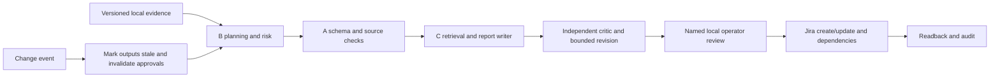

# MA6094 Harbourline — Integrated A/B/C Backend

Member B's planning/risk implementation and Member C's memory/writer/critic
contracts are integrated into A's Python orchestrator. Jira approvals, readback,
audit export and change invalidation are implemented for local trusted operators.
The public Sites preview is separate; this backend is not deployed behind it.

## Start locally

Python 3.11+ (tested with Python 3.12):

```bash
python3 -m venv .venv
source .venv/bin/activate
python -m pip install -r requirements.txt
python scripts/audit_schemas.py
python -m unittest discover -s tests -v
```

To reproduce a **scripted integration test**, first prepare the exact supplied brief:

```bash
python scripts/prepare_evidence.py --brief "/path/to/MA6094 Capstone Brief.pdf"
python -m harbourline.operations run \
  --start 2027-03-01 --end 2027-03-31 --cutoff 2027-04-06 \
  --scripted-test
```

The 2027 dates above select a **fictional course simulation**, not current real
project progress. The test really runs B's rules engine and the new C orchestration,
but model responses are scripted and Jira is not contacted. Test reports cannot be
released or sent to real Jira through the CLI. `.local/` holds output and logs.

## Live model and Jira setup

See [RUNBOOK](docs/INTEGRATION_RUNBOOK.md) for environment configuration, source
availability dates, live model mode, exact human approvals and Jira configuration.
No API key is included. `.env.example` is a field guide, not an automatically loaded
credential file. The live dependencies are in requirements-live.txt.

## Data flow



Both audiences use the same verified snapshot and B context; their reporting
periods are configurable separately. Original four team schemas remain unchanged.
C's projection is still derived from Full and retains the team's data contract.

## Scope and evidence

- Original B branch: member-b-planning-risk, commit 826336f8bc1bb80f7a3de527a00c91f2a1b5e69f.
- Original C branch: feature/member-c, commit 98df55dc9f58aa35c4758b2da78404fec75e021c.
- New C service reuses C's structured draft schemas and connects the full
  writer/critic/revision workflow without shared mutable report files.
- Lexical retrieval is available without embeddings; an optional portable semantic
  index preserves the semantic retrieval route (see runbook).
- B's deterministic proposal engine is the zero-model-call baseline. Optional
  `--plan-mode live` asks a model to refine its plan/risk output and validates it.
- [Verification](docs/INTEGRATION_VERIFICATION.md) records exactly what was tested.
- OpenAI/Jira credentials, the full Data Pack and sponsor responses were unavailable
  during integration. No successful live OpenAI/Jira run or free-path verification
  is claimed. Team API samples remain historical evidence from the original C PR.
- The local approval CLI trusts the OS account. It is not a public multi-user auth
  service. Keep it private; do not expose arbitrary `aggregate(a,b,c)` or governance
  methods as network endpoints. Audit hashes detect changes, not a hostile OS owner.

AI assistance was used for the integration. Team review and the assessed business
case evaluation, fairness work, documents and presentation remain separate tasks.
